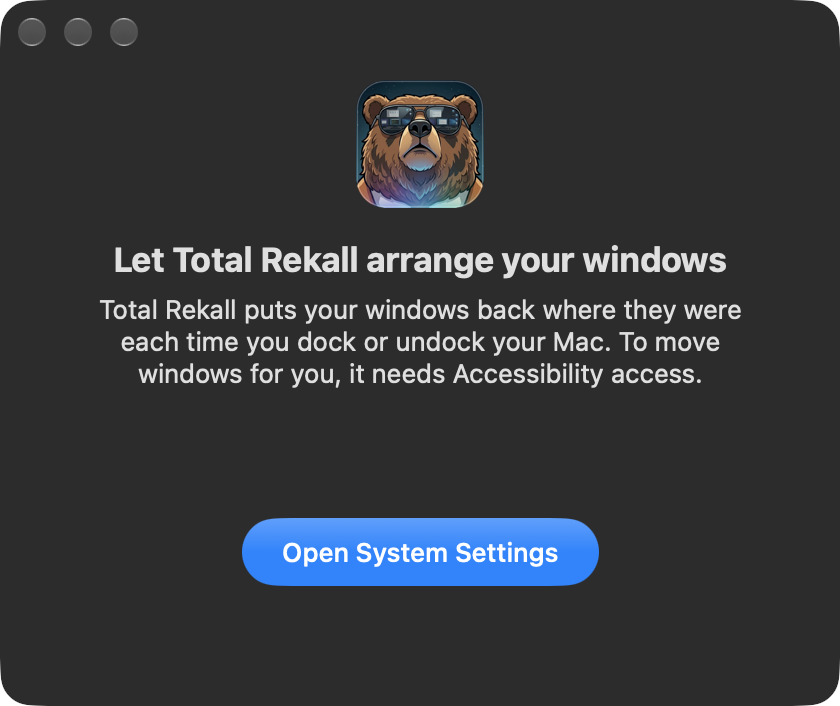
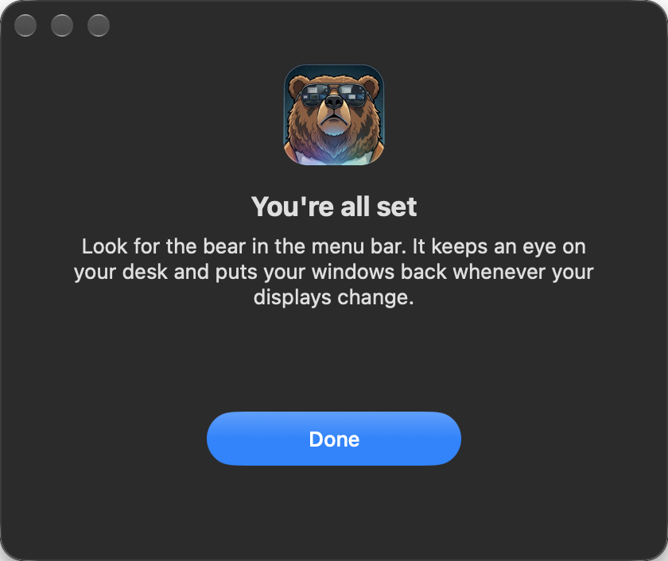
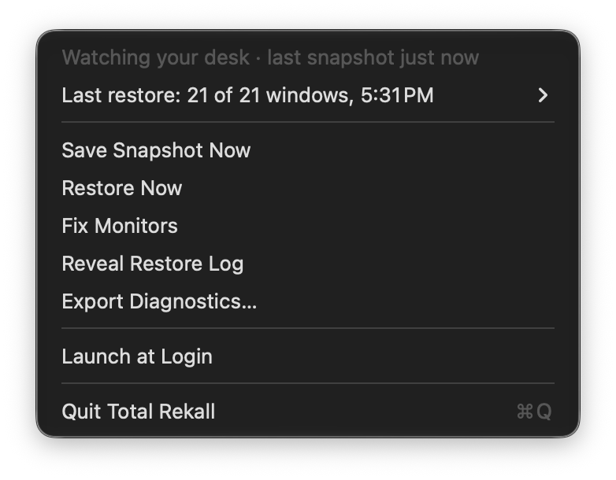

# Total Rekall

<p align="center">
  
</p>

<p align="center"><strong>Your desk, the way you left it.</strong></p>

Tired of fixing your monitors and app locations each time you reconnect your Mac to your dock? Monitors arranged incorrectly, windows all over the place.

Total Rekall fixes that. It remembers your setup and restores your monitor order, window positions and sizes, and desktops when you reconnect. It runs quietly from your menu bar, so you can get back to what you were doing.

## What it restores

- **Monitor order/arrangement.** Puts your monitors back in the right arrangement, so moving between screens works the way you expect.
- **Window positions and sizes.** Returns your windows to the right screens, at the size and position you left them.
- **Desktops (Spaces).** Moves windows back to the desktops they were on before you undocked.

While you're docked, Total Rekall saves your layout automatically. When you reconnect, it puts everything back where it was.

## Support the project

Total Rekall is free. If it saves you some window-dragging, you can buy me a coffee.

<a href="https://www.dynamiccorporateleader.com/offers/LC2KfjsD"></a>

## Get started

You'll need **macOS 26 (Tahoe) or later** and a Mac you connect to external monitors.

### Install from a disk image

If you have a `TotalRekall-<version>.dmg`:

1. Open it and drag **TotalRekall** into **Applications**.
2. Open **TotalRekall**.
3. Follow the setup window to enable **Accessibility** in System Settings.

<table>
  <tr>
    <td align="center"></td>
    <td align="center"></td>
  </tr>
  <tr>
    <td align="center">First launch: turn on Accessibility</td>
    <td align="center">Access granted</td>
  </tr>
</table>

Builds are not yet notarized by Apple. If macOS blocks the first launch, go to **System Settings > Privacy & Security** and choose **Open Anyway**. See the [user guide](docs/USER_GUIDE.md) for the full steps.

### Build from source

Requires **Xcode 26 or later**.

```sh
git clone https://github.com/productengineered/TotalRekall.git
cd TotalRekall
scripts/install.sh --adhoc
```

The script builds the app, installs it in `/Applications`, and opens it. No developer account is required for this option. Ad-hoc builds may need Accessibility permission granted again after each reinstall.

For a stable signing identity, copy `app/Config/Local.xcconfig.example` to `app/Config/Local.xcconfig`, enter your Apple developer team ID, and run `scripts/install.sh` without `--adhoc`.

You can also open `app/TotalRekall.xcodeproj` in Xcode. To package a disk image, run `scripts/make-dmg.sh`; the file is written to `dist/`.

### Once it's running

Create your first snapshot by clicking the bear icon  in the menu bar and choosing **Save Snapshot Now**. After that, dock and undock as usual. Choose **Launch at Login** if you'd like Total Rekall to start with your Mac.

<p align="center"></p>

The [user guide](docs/USER_GUIDE.md) covers setup, menu controls, troubleshooting, and uninstalling.

## Permissions and privacy

Total Rekall needs **Accessibility** permission to read and change window positions and sizes. It saves window titles and app names locally to match windows to their saved locations. It does not record keystrokes or read the contents of your windows.

The app makes **no network requests**. There are no analytics, crash uploads, or update checks. Layouts and logs stay on your Mac in `~/Library/Application Support/TotalRekall`, in a folder restricted to your user account.

The app is not sandboxed. It also requests notification permission so it can alert you when an automatic restore needs attention.

## Limitations

**Space restoration uses private macOS APIs.** Apple can change these in a macOS update. If they become unavailable, Total Rekall falls back to restoring window positions and sizes without moving windows between Spaces. This also prevents distribution through the Mac App Store.

## Report a problem

Choose **Export Diagnostics…** from the bear menu, then [open an issue](https://github.com/productengineered/TotalRekall/issues) with the ZIP, your macOS version, your monitor setup, and what went wrong.

The ZIP is saved to your Desktop, with a fallback to the app's local data folder. Window titles are redacted and raw saved layouts are excluded. App names and display serial numbers are included, so you can inspect it before sharing. Nothing is uploaded automatically.

<details>
<summary>Local files and resetting the app</summary>

Data is stored in `~/Library/Application Support/TotalRekall`:

- `snapshots.json` and `snapshots.last-good.json`: saved layouts, including window titles.
- `restore-log.json`: restore results.
- `exports/`: diagnostics exports when the Desktop is unavailable.
- `instance.lock`: prevents multiple copies from running at once.

To clear saved layouts and logs, quit Total Rekall, delete this folder, and reopen the app. To also remove preferences, run:

```sh
defaults delete com.productengineered.TotalRekall
```

</details>

## License

A license has not yet been selected.
